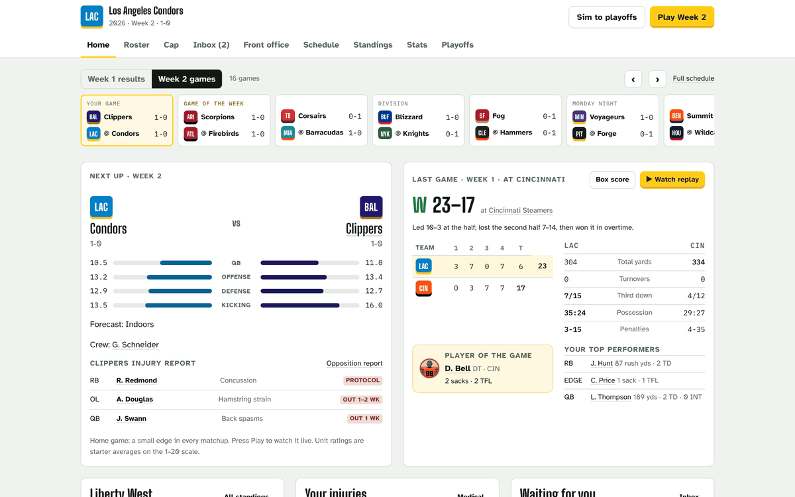
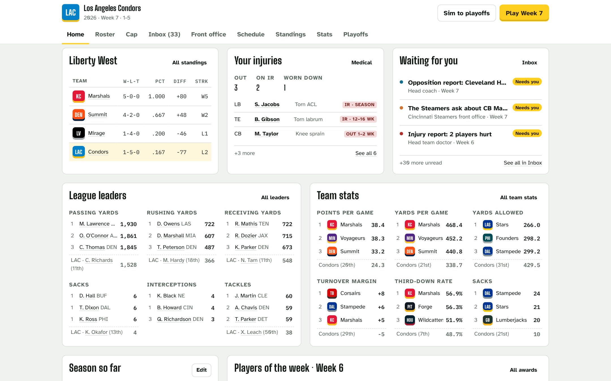
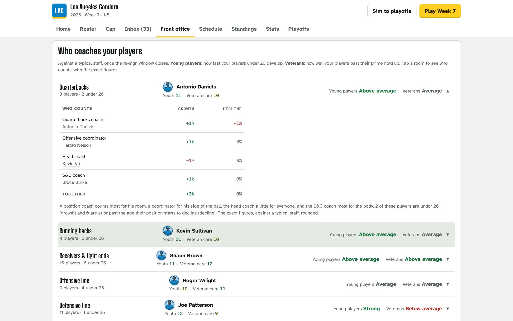
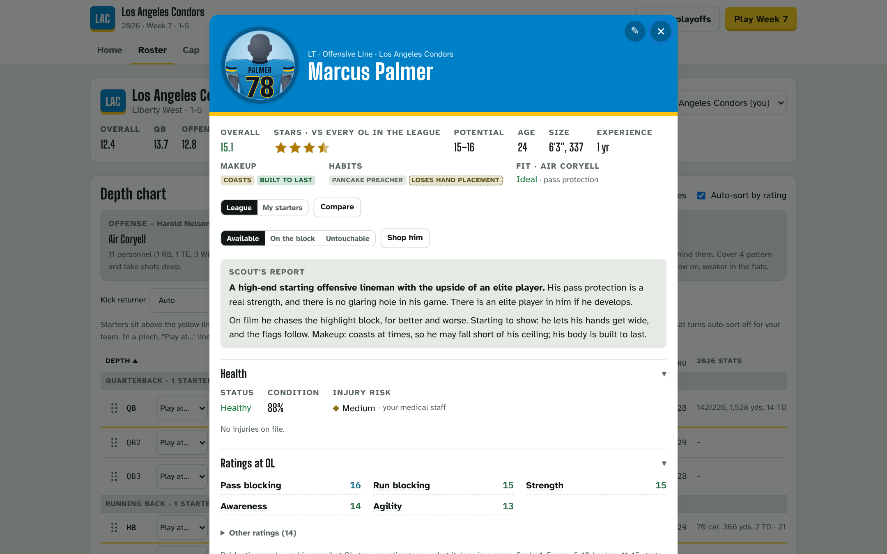
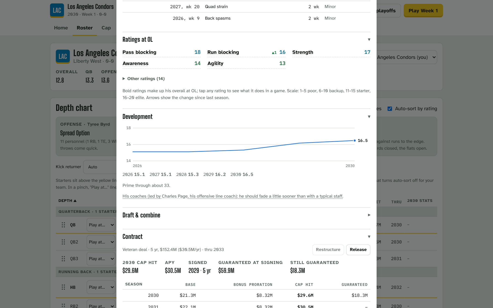

# AFLS

A deep American football management simulation: run a franchise in a fictional 32-team league, complete with divisions/conferences, weather, authentic kickoff times, and more.
Build the roster and the coaching staff along with back office staff, and watch every snap play out from real player-vs-player matchups.
Everything your front office knows is what its scouts have seen, so the game lives in the gap
between what you believe and what is true. Think you know ball?



<table>
  <tr>
    <td width="50%"><br><sub><b>Home.</b> Standings, injuries, what the inbox needs from you, league leaders and team stats.</sub></td>
    <td width="50%"><br><sub><b>Coaches.</b> Open a room to see who counts for its players' growth and decline, and by how much.</sub></td>
  </tr>
  <tr>
    <td width="50%"><br><sub><b>A player, year one.</b> The scout's report, his habits, his health, and the ratings behind his overall.</sub></td>
    <td width="50%"><br><sub><b>The same player, four seasons on.</b> Arrows since last year, his development curve, and the deal he earned.</sub></td>
  </tr>
</table>

## What's in the game

- **Every snap is a matchup.** Pass protection against the rush, routes against coverage, tackles
  against the open field: each play is resolved from named contests between the players on the
  field, and league totals land inside real NFL ranges.
- **You see what your scouts see.** Other teams' players are ranges that narrow with film; hidden
  traits and habits are described in words, never numbers. Scout reports read like a staff wrote them.
- **A front office with teeth.** Year-by-year contract ledgers with proration, dead money and
  restructures; tags, the rookie scale, re-signings, free agency and a draft fed by a combine.
- **A trade market that judges every deal.** AI front offices value players on their own read,
  shop at the NFL's moments (deadline day, cap casualties, camp cuts), send you offers, and run every
  deal past the buyer's doctor.
- **Staff who matter.** Scouts set how sharp your read is, coaches shape development and call the
  game through their schemes, the medical staff decide how fast players heal. Each has a budget,
  contracts, a market and a carousel.
- **Players grow, fade and change.** Development and aging on one curve, hidden traits, on-field
  habits that come and go week to week, and position moves taught over a season.
- **Injuries you have to manage.** Snap and collision risk, layoffs with the doctor's estimate,
  injured reserve, treatments with the player's say, and a concussion protocol.
- **A league that runs like one.** NFL-formula schedules, kickoff windows and flex scheduling,
  weather by stadium, officiating crews with tendencies, penalties, records and awards.
- **A watchable game.** Live play-by-play with a field view, box scores, and an inbox where your
  head coach, scouting director and doctor each write in their own voice.
- **Saves you own.** The game saves to your browser and exports a backup file; one command builds
  a single self-contained HTML file to share.

## Play

```bash
npm install
npm run dev        # open the printed local URL
```

The game runs in your browser and saves there. It is not hosted anywhere yet.

## Develop

Start with `npm run check`. It reads what you changed, runs the checks that change calls for side
by side, and prints one line each. CI runs the same plan on every pull request, so a red line here
is a red check there.

```bash
npm run check            # the checks your change needs; --quick skips the slow ones, --all runs everything
npm run typecheck        # tsc, no emit
npm test                 # engine and UI tests (vitest); npm run test:watch keeps them running
npm run build            # production web build in dist/
npm run build:single     # one self-contained page at dist-single/afls.html, for sharing
npm run preview          # serve the production build locally

npm run sim -- 10        # simulate seasons and compare league stats, leaders and injury rates to the NFL's
npm run endings          # audit thousands of game endings for clock-management nonsense
npm run offseason -- 6   # run seasons back to back: cap health, rosters, talent and the staff economies
npm run audit            # raise each rating in turn and check it moves play; rewrites docs/ATTRIBUTES.md
npm run careers          # age a draft class: peaks, declines, retirements, trait and coaching effects
npm run quirks           # the on-field habit bag: how often habits are carried, gained and lost
npm run weather          # roll seasons of weather and check it looks like the NFL's
npm run crews            # officiating crews: flags per game, busiest against quietest, the rotation
npm run trades           # the trade market against NFL prices, every AI deal read as it closes
npm run training         # position moves and development released in steps
```

See [`docs/GAME_DESIGN.md`](docs/GAME_DESIGN.md) for the vision, how the engine works and the
roadmap, and [`CLAUDE.md`](CLAUDE.md) for the working notes on the codebase.
