# AFLS

**A deep American football management sim: Football Manager's depth, pro football's rules, a league of your own.**

Run a franchise in a fictional 32-team league, complete with divisions and conferences, weather, authentic
kickoff times, and more. Build the roster, the coaching staff and the back office, and watch every snap play
out from real player-vs-player matchups. Everything your front office knows is what its scouts have seen, so
the game lives in the gap between what you believe and what is true. Think you know ball?

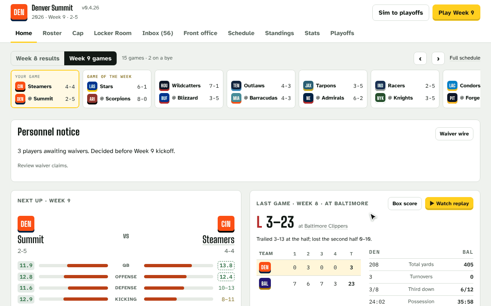

<sub>A week at the desk: Home, the head coach's weekly letter, the depth chart and a rookie's card, a trade
offer for him, then (in the dark theme) the locker room and a 48-yard touchdown run in All-22.</sub>

**Status: alpha (0.4).** Every item on the [MVP list](docs/MVP.md) works end to end. It runs in your browser
and saves there: no account, no server, no install beyond `npm`.

[On film](#every-snap-on-film) · [What's in the game](#whats-in-the-game) · [Screens](#screens) ·
[Light and dark](#light-and-dark-desktop-and-phone) · [Checked against the NFL](#checked-against-the-nfl) ·
[Play](#play) · [Under the hood](#under-the-hood) · [Develop](#develop) · [Docs](#docs) ·
[What's next](#whats-next)

## Every snap, on film

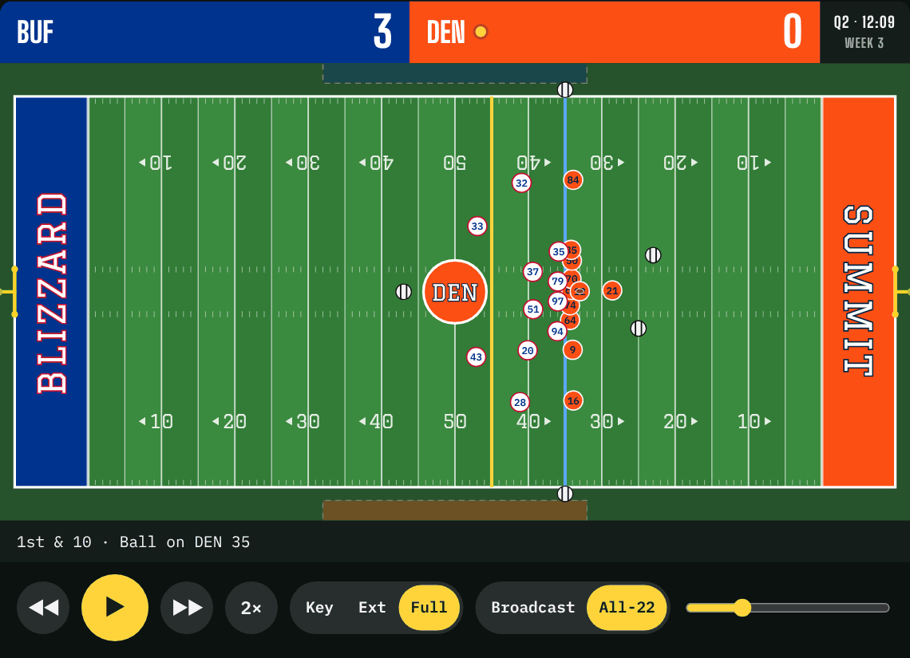

<sub>Week 3 against Buffalo, 1st and 10 at our own 35: Spencer to Franklin deep right for 46 yards.</sub>

The play-by-play engine decides what happened from the matchups on the field: protection against the rush,
routes against coverage, the passer's read, the tackle in the open field. In your games a spatial engine then
plays it out, twenty-two men at twenty steps a second. The line sets and the rush gets home or doesn't, the
quarterback throws, throws it away or takes off, the back reads his blocks, the chase runs him down, and the
man who gets there is the man credited with the tackle. Watch any of your games back, snap by snap, in All-22
or the broadcast view.

## What's in the game

**On the field**

- **Every snap is a matchup.** Each play is resolved from named contests between the players on the field,
  and league totals land inside real NFL ranges ([the numbers](#checked-against-the-nfl)).
- **Choices, not flat odds.** A passer under pressure, a runner at the sideline with the clock running, a
  scrambler deciding to slide, a coach going for two: each reads the down, the score, the clock and the man.
  The play-by-play says why ("slides with the first down in hand", "steps out of bounds to stop the clock").
- **Size, schemes and habits.** Height and weight matter where they decide things (contested balls, the jam,
  the trenches). Coordinators run real offenses, fronts and coverages. Players carry on-field habits that come
  and go, and you learn them the way a club does: your scouts see them on film.
- **Weather, crews and the clock.** Weather by stadium and season with forecasts that come true as often as
  they say, seventeen officiating crews with their own tendencies, and end-of-game clock management audited
  for nonsense.

**The front office**

- **You see what your scouts see.** Other teams' players are ranges that narrow with film; hidden traits and
  habits are described in words, never numbers. Scout reports read like a staff wrote them.
- **A cap with teeth.** Year-by-year contract ledgers with proration, dead money, restructures and void years;
  tags, fifth-year options, the rookie scale, re-signings, free agency and a seven-round draft fed by a combine.
- **A trade market that judges every deal.** AI front offices value players on their own read, shop at the
  NFL's moments (deadline day, cap casualties, camp cuts, draft day), send you offers, and run every deal past
  the buyer's doctor.
- **General managers who are people.** Each AI GM has hidden habits (signs a bridge quarterback, trades firsts
  for stars, goes gun-shy on big deals) and remembers how you've dealt with him. It leans his price, his
  patience and whether he calls you first.
- **The 53 and the 16.** Practice squads, the waiver wire, game-day call-ups, poaching and protections, with AI
  clubs covering their injuries the way real ones do.

**The people**

- **Staff who matter.** Scouts set how sharp your read is, coaches shape development and call the game through
  their schemes, the medical staff decide how fast players heal. Each has a budget, contracts, a market, a
  carousel and coaching trees that grow over the years.
- **Players grow, fade and change.** Development and aging on one curve, ceilings that settle over a player's
  first three seasons (first-rounders bust, Day 3 picks break out), position moves taught over a season, and
  veterans mentoring the young.
- **A locker room.** Every player has a mood with reasons behind it: his deal, his snaps, the losing, a feud.
  He'll come to you about it. You promise, reassure or stand firm, and promises are kept or broken by what
  happens next. Ignore it and you get hold-ins, holdouts and trade requests that leak.
- **Leaders, meetings and belief.** Leaders and voices set the tone of each position room. Your head coach
  suggests team meetings when a room turns, chemistry moves play a little on Sunday, and a coordinator who
  loses his room can be relieved in season.
- **Injuries you have to manage.** Snap and collision risk, layoffs with the doctor's estimate, injured
  reserve, treatments with the player's say, and a concussion protocol.

**Your desk**

- **An inbox worth reading.** Your head coach, scouting director, doctor, the owner, agents and rival GMs each
  write in their own voice, and the head coach's weekly letter tells your club's storylines as they unfold.
  The league's news desk and a stats column cover everyone else.
- **A job you can lose.** Owners have budgets, patience and a memory. Bad seasons put heat on the GM or the
  head coach; you can be fired, take another club's offer, or watch from the outside until one comes.
- **A league that runs like one.** NFL-formula schedules, kickoff windows and flex scheduling, standings with
  tiebreakers, a 14-team playoff, records, awards and career histories for players, coaches and GMs.
- **Saves you own.** The game autosaves to your browser, exports a backup file, and migrates old saves on
  load; one command builds a single self-contained HTML file to share.

## Screens

<table>
  <tr>
    <td width="50%">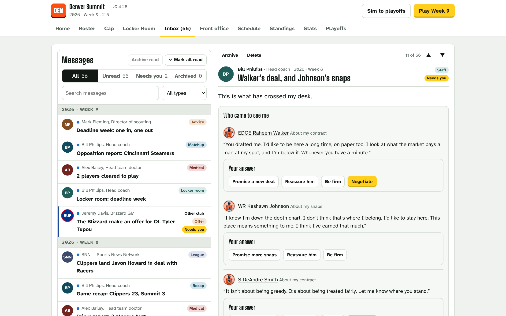<br><sub><b>The head coach's letter.</b> Who came to see him this week, in their words, and your answer to each.</sub></td>
    <td width="50%">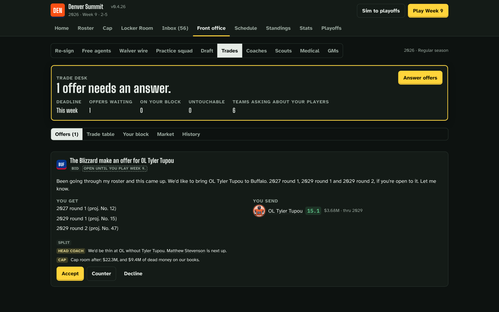<br><sub><b>The trade desk.</b> Buffalo wants the rookie tackle. Your coach and your cap sheet weigh in before you answer.</sub></td>
  </tr>
  <tr>
    <td width="50%">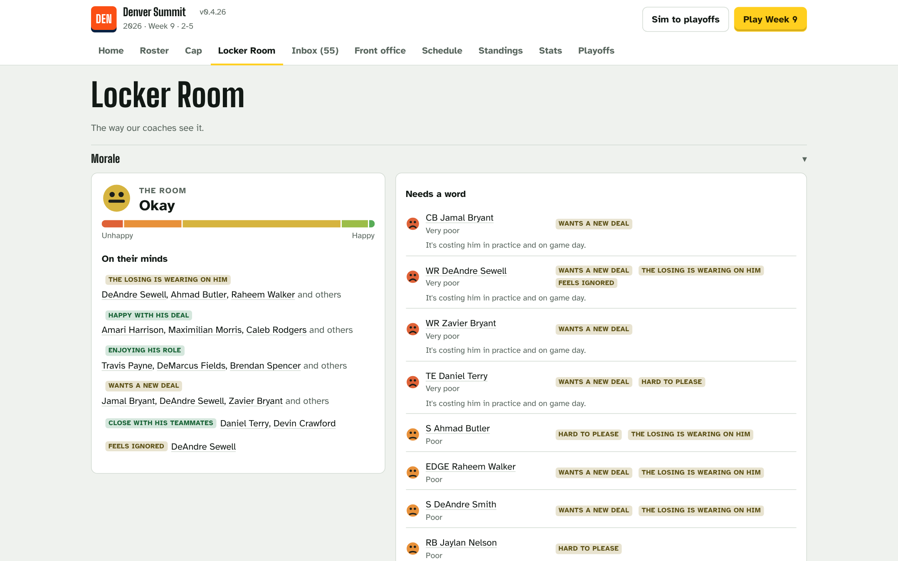<br><sub><b>The Locker Room.</b> The room's mood, what's on their minds, and who needs a word.</sub></td>
    <td width="50%">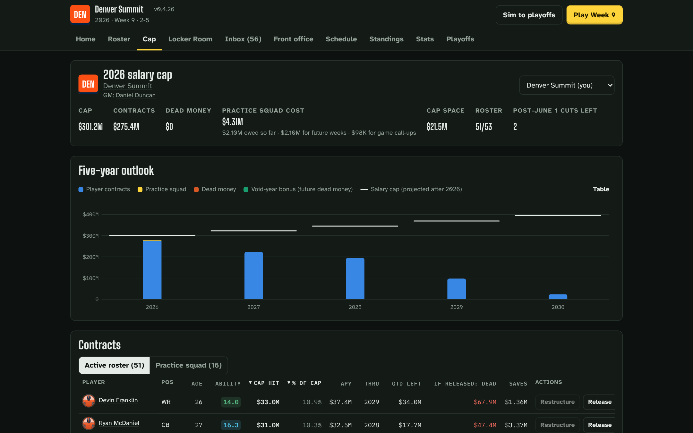<br><sub><b>The cap.</b> This year's sheet, the five-year outlook, and what every release would cost.</sub></td>
  </tr>
</table>

### One player, two seasons apart

<table>
  <tr>
    <td width="50%" valign="top">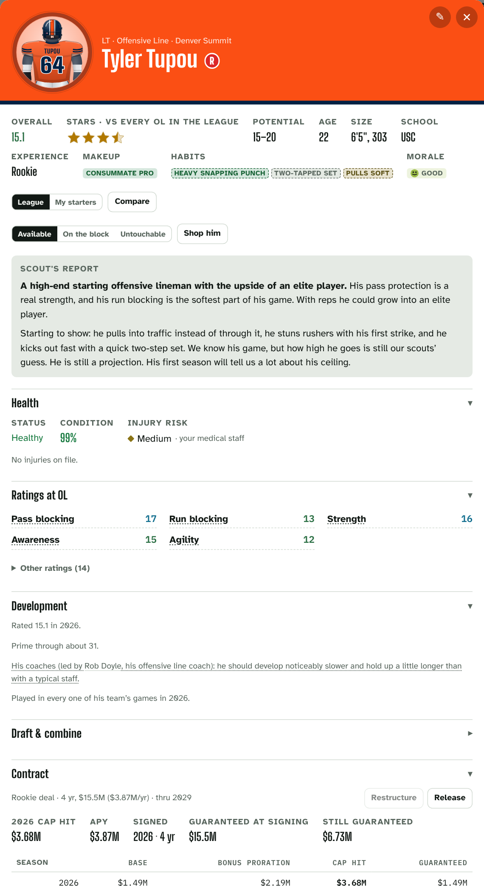<br><sub><b>2026, a rookie.</b> Rated 15.1, and his ceiling is a range (15–20): "how high he goes is still our scouts' guess."</sub></td>
    <td width="50%" valign="top">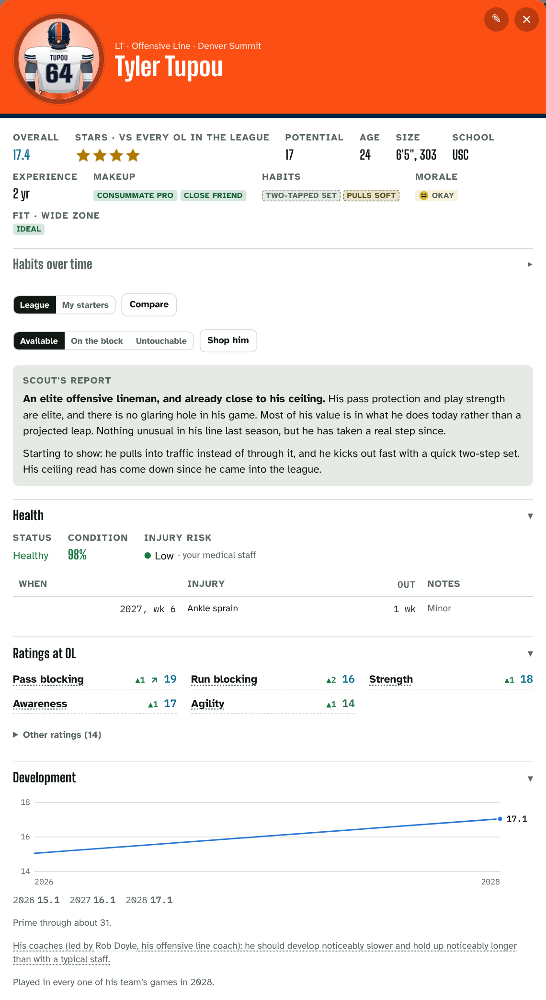<br><sub><b>2028, the same player.</b> Rated 17.4. The range has closed to 17, the report says so, and the curve shows how he got there.</sub></td>
  </tr>
</table>

The save behind these pictures was left to play itself for four seasons. The general manager went 5–12, 11–6
and 7–10 in Denver, was dismissed, and was hired that spring by New York, a 2–15 club that won ten games the
next year.

## Light and dark, desktop and phone

<table>
  <tr>
    <td width="50%">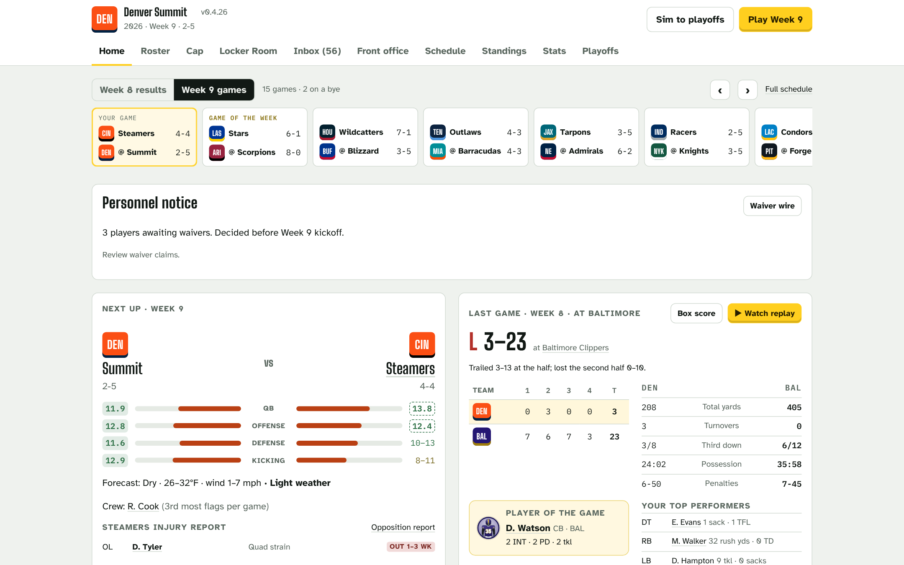<br><sub><b>Home, light.</b></sub></td>
    <td width="50%">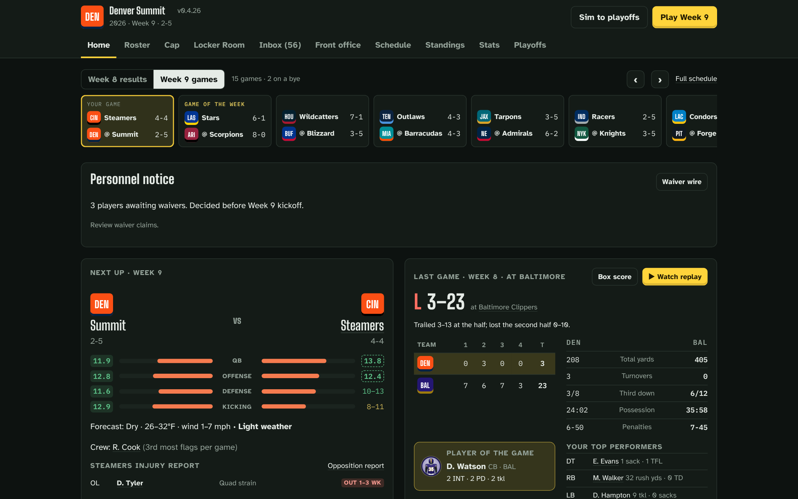<br><sub><b>Home, dark.</b> Or follow your device's setting.</sub></td>
  </tr>
</table>

<table>
  <tr>
    <td width="25%">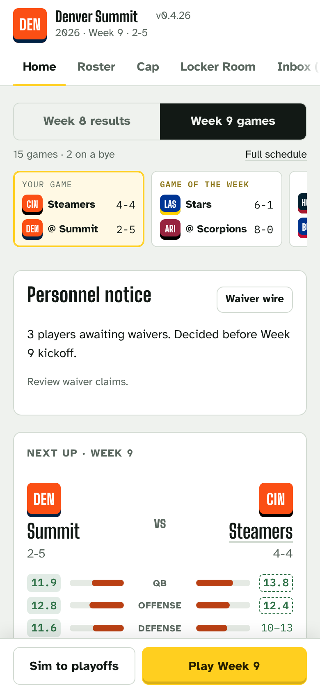</td>
    <td width="25%">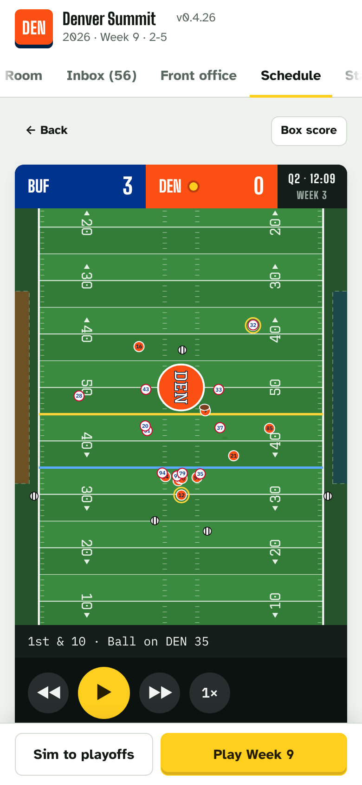</td>
    <td width="25%">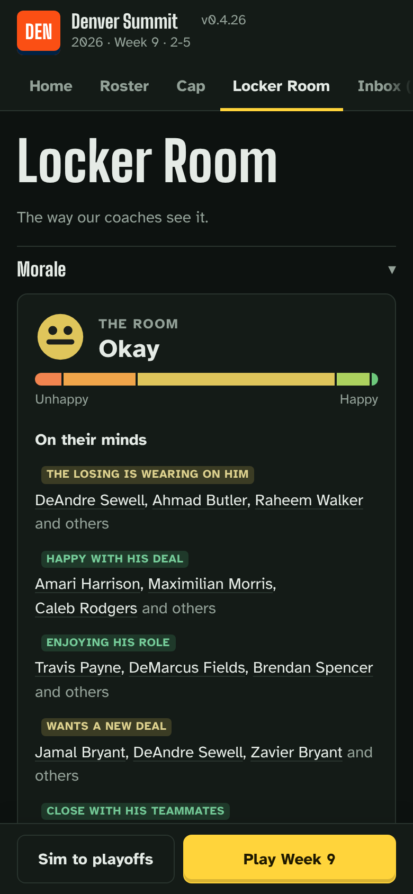</td>
    <td width="25%">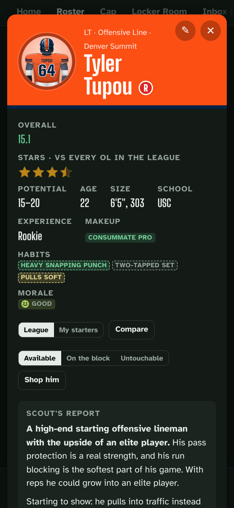</td>
  </tr>
</table>

<sub>Every screen has a phone layout, the film room included: the field turns upright.</sub>

## Checked against the NFL

Nothing here is tuned by feel. Each system has a script that plays thousands of games or many seasons and
holds the result to ranges taken from real data (nflverse play-by-play, FTN charting, Next Gen Stats, combine
and roster records). The same scripts run on every pull request.

One ten-season run of this build (2,720 games, `npm run sim -- 10`), per team per game:

| Stat               |   Sim | NFL range |
| ------------------ | ----: | --------: |
| Points             |  21.9 | 21.5–23.5 |
| Plays              |  61.7 |     61–65 |
| Total yards        | 327.6 |   315–345 |
| Completion %       |  64.4 |   63–66.5 |
| Yards per attempt  |  6.99 |   6.7–7.3 |
| Yards per carry    |  4.21 |   4.1–4.5 |
| Sacks              |  2.33 |   2.1–2.6 |
| Interceptions      |  0.71 | 0.65–0.85 |
| Third-down %       |  39.9 |     37–41 |
| Field goal %       |  86.1 |     83–88 |
| Penalties          |  6.02 |     5.5–7 |
| Home team wins (%) |  54.5 |     53–57 |

Not every line lands in every sample: in that run rushing attempts came in at 25.9 against a range of 26–29,
and it was flagged. Ten seasons is a quick look; CI plays sixty.

The same idea runs through the rest of the game:

- **Play by situation.** Out of bounds by the clock and the side of the field, what a passer does under
  pressure, fumbles by the hit, who gets a loose ball, interceptions by the throw's depth, a sack's yards, a
  play's time, two-point tries and returns, each fitted bucket by bucket.
- **Careers.** Peaks, declines and retirements by position, draft busts and late-round breakouts, and season
  leaders against the NFL's leaders and records.
- **Front offices.** What a star, a starter and a deadline rental cost in trade, how many deals close and
  when, who re-signs and who reaches free agency, cap health and roster sizes over back-to-back seasons.
- **Everything else.** Injury rates, weather, flags per crew, coaching turnover, the league's moods. And an
  audit that raises each rating in turn and fails if it doesn't move play: no attribute is decoration.

## Play

```bash
npm install
```

```bash
npm run dev
```

Open the local URL it prints. The game runs in your browser and saves there. It is not hosted anywhere yet.

To hand someone a copy, `npm run build:single` writes one self-contained page to `dist-single/afls.html`.

## Under the hood

- **The engine is plain TypeScript** (`src/engine/`, about 40,000 lines): no DOM, no React, no `Math.random`.
  All randomness goes through a seeded generator, so a league seed rebuilds the same world and any game can be
  replayed exactly.
- **The league is one plain JSON document.** It autosaves to IndexedDB, exports as a file, and every change
  to its shape ships with an upgrade step, so old saves are migrated on load, never thrown away.
- **True against perceived.** The match engine, development and contracts use true ratings. AI front offices
  decide about other teams' players on their own scouts' read, and the screens show only your view. Tests
  hold every screen to that.
- **The UI is React** (`src/ui/`), built with Vite, with one set of rules for every screen
  ([`docs/UI.md`](docs/UI.md)).
- **About 3,000 tests** and some two dozen calibration scripts, planned per change: a pull request runs the
  checks its diff calls for, one CI job each.

```
src/engine/    the simulation: match engine, field, scouting, staff, finance, offseason, trades, morale
src/ui/        the screens, one mutable League in a store, autosaved
scripts/       the checks and previews (sim, careers, trades, screens, ...)
docs/          design, research and the spec for each system
```

## Develop

`npm run check` reads what you changed against `origin/main`, runs the checks that change calls for side by
side, and prints one line each. CI runs the same plan on every pull request, so a red line here is a red
check there.

```bash
npm run check            # the checks your change needs; --quick skips the slow ones, --all runs everything
npm run typecheck        # tsc, no emit
npm test                 # engine and UI tests (vitest); npm run test:watch keeps them running
npm run format           # prettier
npm run build            # production web build in dist/
npm run preview          # serve the production build locally
```

The checks, each run after changing its area:

| Area | Commands | What they hold |
| --- | --- | --- |
| League totals | `sim`, `endings` | League stats, leaders and injury rates against the NFL's; game endings audited for clock-management nonsense |
| Play by situation | `sideline`, `passer`, `fumbles`, `picks`, `dropback`, `situations` | Each kind of play, bucket by bucket, against nflverse and charting data |
| The field | `parity`, `film` | The spatial engine against the play-by-play engine on the same moments; All-22 against tracking numbers |
| Ratings and builds | `audit`, `size`, `quirks` | Every rating, build and habit moves play the right way |
| Game day | `weather`, `crews` | Weather like the NFL's and what it costs; flags per crew |
| Careers | `careers`, `training` | Peaks, declines, retirements and draft outcomes; position moves and development released in steps |
| Front offices | `offseason`, `trades`, `gm-habits` | Cap health, rosters and free agency over seasons; trade prices and exploit probes; AI GMs' habits |
| The 53 and the 16 | `waivers`, `squads`, `elevations`, `poaching` | Practice squads, claims, call-ups and poaching stay legal all season |
| The locker room | `morale` | Moods, talks, meetings, chemistry and belief in the staff, all in range |
| Previews (not checks) | `screens`, `copy`, `mail-preview`, `gm-letters` | Screenshots of the real app from a save, every sentence a screen can show, letters at each moment of the year |

Each is `npm run <name>`; [`CLAUDE.md`](CLAUDE.md) has the arguments, the run times and when to run which.

## Docs

- [`docs/GAME_DESIGN.md`](docs/GAME_DESIGN.md): the vision, how the engine, scouting, development, coaching
  and the front office work, and the roadmap.
- [`docs/MVP.md`](docs/MVP.md): the checklist to alpha and what has landed since, with the numbers each
  change was held to.
- By system: [attributes](docs/ATTRIBUTES.md), [injuries](docs/INJURIES.md), [trades](docs/TRADES.md),
  [training](docs/TRAINING.md), [practice squads](docs/PRACTICE_SQUADS.md), [weather](docs/WEATHER.md),
  [penalties](docs/PENALTIES.md), [officials](docs/OFFICIALS.md), [player habits](docs/QUIRKS.md),
  [coach habits](docs/COACH_QUIRKS.md), [names](docs/NAMES.md), [news](docs/NEWS.md),
  [avatars](docs/AVATARS.md).
- [`docs/UI.md`](docs/UI.md): the rules every screen follows, including what a screen may show through the
  fog of war and how screen text is written.
- [`docs/research/`](docs/research/): the market research and the real-world studies behind the numbers.
- [`docs/superpowers/specs/`](docs/superpowers/specs/): the design spec for each system, written before it
  was built.
- [`CLAUDE.md`](CLAUDE.md): working notes on the codebase and its conventions.
  [`docs/VERSIONING.md`](docs/VERSIONING.md): how versions are counted.

## What's next

- **News and media.** A league news desk and a stats column are in the inbox today; full outlets and season
  storylines for the whole league come next ([`docs/NEWS.md`](docs/NEWS.md)).
- **A deeper scouting network.** Departments, budgets and per-scout reads are in; regions are not.
- **More of the owner.** Goals and broader job security on top of today's reviews, firings and hirings.
- **Modding.** League import and export and an in-game editor, so the community can make its own leagues.
- **Off the browser.** Desktop packaging, then a public prototype.

## Names

AFLS is a fictional league. Teams play in real cities with original nicknames, and every player, coach and
executive is generated. It is not affiliated with or endorsed by the NFL or any club, and it ships no real
names, logos or trademarks.
